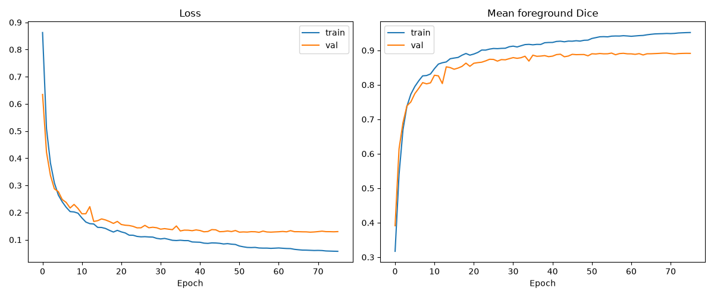
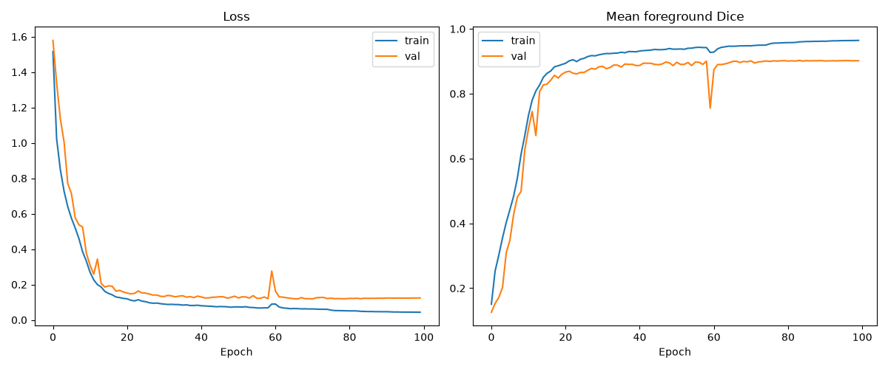
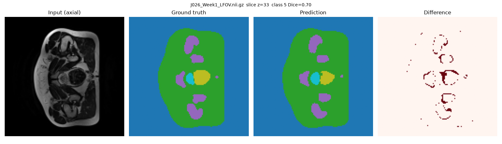
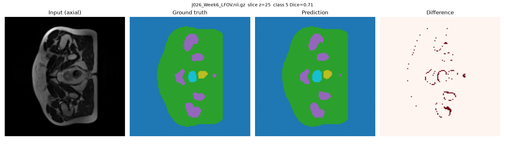
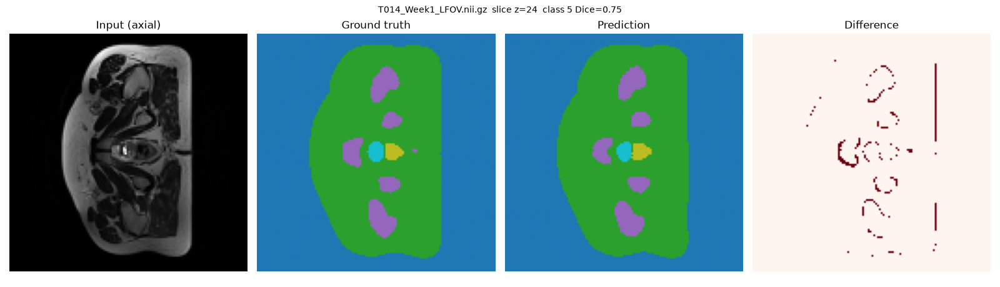
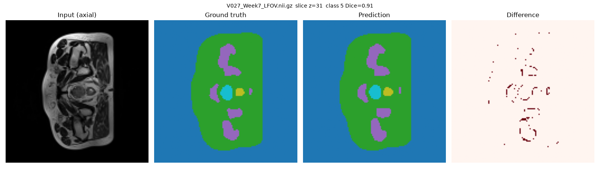
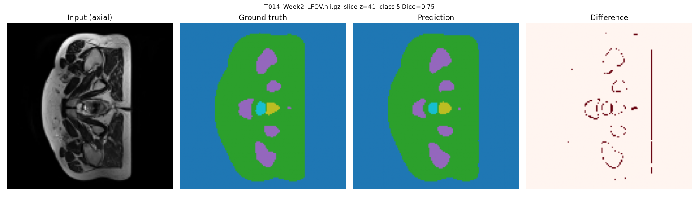
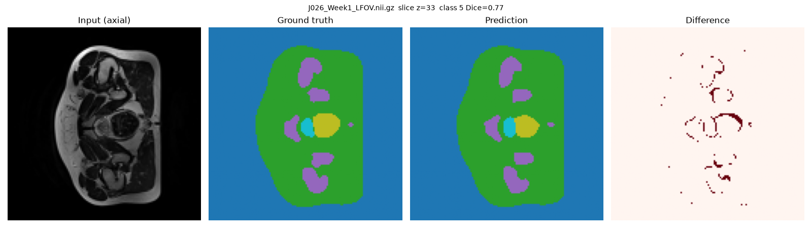

# HipMRI Prostate MRI Segmentation: 3D Improved U-Net (Hard) with 3D U-Net baseline

*COMP3710 Pattern Recognition Report, Marcus Wee Lam Seow, s48747240*

**Selected model: 3D Improved U-Net on downsampled HipMRI 3D volumes (Hard difficulty).** A plain 3D U-Net is used as the baseline for comparison.

## 1. Project description

Radiotherapy planning needs accurate contours of the prostate and the organs around it. This project segments pelvic MRI volumes from the HipMRI study into six labels (label 0 plus five anatomical structures). The task target is Dice >= 0.7 on the test set.

**How it works.** The 3D Improved U-Net follows Isensee et al. (2018), adapted to 3D:
- pre-activation residual *context modules* (two 3x3x3 convolutions with spatial dropout 0.3 between them and a skip connection);
- instance normalisation (GroupNormalization with one group per channel) and leaky ReLU (slope 0.01) in place of batch norm and ReLU;
- strided 3x3x3 convolutions for downsampling (five levels, 16 to 256 filters);
- *localization modules* in the decoder (3x3x3 then 1x1x1 convolution);
- deep supervision: segmentation outputs from the three highest-resolution decoder levels are upsampled and summed before the softmax, which keeps a single output.

It has 8,267,618 parameters. The baseline is a standard 3D U-Net (Cicek et al., 2016): four levels (16 to 128 filters), a 256-filter bottleneck, max pooling, transposed-convolution upsampling, batch norm and ReLU (5,650,886 parameters). Both models use the same data, split, loss and optimiser, and are evaluated on the same 27 test volumes.

**Loss and optimiser.** Mean per-class soft Dice loss plus categorical cross-entropy, Adam (lr 5e-4, halved on validation-loss plateau), batch size 2, up to 100 epochs, early stopping (patience 20) and best-checkpoint saving on validation foreground Dice. The per-class Dice loss is used instead of a global Dice term because a global term is dominated by background voxels, which would otherwise swamp the signal from small structures.




## 2. Data use and acknowledgments

This project uses data from the **HipMRI Study**, accessed via the University of Queensland's Rangpur HPC cluster (`/home/groups/comp3710/HipMRI_Study_open/`), under the terms of the HipMRI Study data use agreement.

**Acknowledgments:** Data were provided in part by the HipMRI Study.

**Citation:** The agreement leaves the citation for image segmentation blank (`data_use_agreement.txt`). This has been raised with the teaching team and will be updated once confirmed. In the interim, the following publications listed in the agreement are cited:

- HipMRI Study for MRI-alone treatment planning and other imaging: https://doi.org/10.1016/j.ijrobp.2015.08.045
- HipMRI Study for image synthesis and translation: https://arxiv.org/abs/2011.13615
- HipMRI Study for image segmentation: *[citation pending, confirm with teaching team]*

**Data use terms acknowledged:** no attempt has been made to identify or contact any participant; the data and derived results are used for non-commercial coursework only; no warranty is made regarding the correctness of the data.

## 3. Feasibility review

[CHECK: replace this with the one-page review you actually presented at the midpoint check-off. The draft below must match what you presented and measured.]

- **User and acceptance criteria.** User: a clinician reviewing draft contours. Criteria: (1) Dice >= 0.7 on the test set; (2) per-class Dice reported; (3) 3 to 5 failure cases diagnosed; (4) a full training run within a few GPU-hours on one A100.
- **Model and course concepts.** 3D Improved U-Net on downsampled HipMRI 3D volumes (Hard tier), with a 3D U-Net baseline.
- **Preliminary evidence.** A data audit (`check_3d.py`, not committed) found 211 MR volumes paired one-to-one with 211 label volumes from 38 patients; shapes were 256x256x128 for 210 volumes and 256x256x144 for one; labels were values 0 to 5. A 16-volume, 2-epoch smoke test confirmed the model trains on GPU (peak memory 3.3 GB).
- **Risks and fallback.** Small test set, severe class imbalance, cluster node problems. Fallback: revert to the plain 3D U-Net baseline alone if the Improved U-Net does not train reliably in time.

## 4. Data pipeline

Data: `/home/groups/comp3710/HipMRI_Study_open/semantic_MRs` and `semantic_labels_only` (not committed). `B006_Week0_LFOV.nii.gz` pairs with `B006_Week0_SEMANTIC.nii.gz`.

- **Patient-level split.** The first part of the filename (for example `B006`) is the patient ID, and each patient has between 1 and 8 weekly scans. Patients are shuffled with a fixed seed (42) and every scan of a patient goes to exactly one split, with an assertion that the splits are disjoint. The split is 26 / 6 / 6 patients, which gives **136 training, 48 validation and 27 test volumes**. The test patients are J026, K008, S028, T009, T014 and V027. Validation drives early stopping and checkpointing; the test set is used only for final evaluation. [CHECK: confirm with your tutor that the letter-and-number prefix is one patient.]
- **Depth fix.** One volume has 144 slices in depth; it is centre-cropped to 128.
- **Downsampling.** 256x256x128 to 128x128x64. Images use 2x2x2 block averaging; labels use strided (nearest-neighbour) sampling so label values stay valid. Class 5 is about 0.1% of voxels at full resolution, so small structures lose detail in this step.
- **Intensity normalisation.** Each volume is z-scored.
- **Memory.** Images are held as float16 and labels as uint8; one-hot encoding happens per batch on the GPU. (An earlier version held float32 one-hot arrays in RAM and crashed one node.)
- **Augmentation.** Random flip along axis 0 on the training set only. [CHECK: I assumed axis 0 is left-right. Look at the figures in Section 6; if the anatomy looks wrong, say so here.]

## 5. Dependencies and reproducibility

Python 3.11 (conda env `tf`), tensorflow 2.21.0, nibabel 5.4.2, numpy 2.4.6, matplotlib 3.11.2, tqdm 4.70.1. Run on one NVIDIA A100 40 GB on Rangpur, partition `comp3710`, with no `--mem` request (the nodes reject one).

```bash
sbatch train_3d_job.sh            # 3D Improved U-Net -> checkpoints/improved3d_best.keras
sbatch train_3d_baseline_job.sh   # 3D U-Net baseline -> checkpoints/unet3d_best.keras
sbatch predict_3d_job.sh          # figures in predictions_improved3d/
sbatch predict_3d_baseline_job.sh # figures in predictions_baseline3d/
```

The data split and training shuffle use seed 42, but no global TensorFlow seed is set and GPU kernels are nondeterministic, so reruns give slightly different numbers. Checkpoints are not committed.

| File | Purpose |
|---|---|
| `modules_3d.py` | 3D U-Net baseline, 3D Improved U-Net, per-class Dice loss and metric |
| `dataset_3d.py` | Pairing, patient-level split, resizing, normalisation, batching |
| `train_3d.py` | Training, validation, test evaluation, curves, resource profiling |
| `predict_3d.py` | Per-class Dice per test volume and failure-case figures |

## 6. Results

All numbers are from one training run per model. Dice is computed per test volume and averaged, at the 128x128x64 working resolution. Every class is present in all 27 test volumes.

### 6.1 Per-class Dice (27 test volumes, 6 patients)

| Class | 3D Improved U-Net | 3D U-Net baseline |
|---|---|---|
| 0 | 0.998 | 0.998 |
| 1 | 0.986 | 0.987 |
| 2 | 0.912 | 0.921 |
| 3 | 0.931 | 0.946 |
| 4 | 0.842 | 0.847 |
| 5 | 0.817 | 0.837 |
| **Mean foreground (1 to 5)** | **0.897** | **0.908** |

**Target (Dice >= 0.7):** both models exceed 0.7 on every class, including the weakest (class 5: 0.82 and 0.84), so the target is met whichever label is the prostate. [CHECK: the prostate label has not been confirmed with the teaching team. If you confirm it, name the class and quote its Dice here.]

The Improved U-Net did **not** beat the plain 3D U-Net: its mean foreground Dice is about 0.01 lower. With single runs on 6 test patients I treat this as a tie, not a loss, and I make no claim about which architecture is better.

### 6.2 Resource profile

| | 3D Improved U-Net | 3D U-Net baseline |
|---|---|---|
| Parameters | 8,267,618 | 5,650,886 |
| Peak GPU memory (training) | 3.93 GB | 3.26 GB |
| Inference per volume | 119.9 ms | 49.6 ms |
| Epochs run | 76 of 100 (early stopping; best epoch 56) | 100 of 100 |
| Training step time | about 90 to 135 ms | about 66 to 100 ms |
| Approx. training time | ~10.3 min (76 epochs) | ~10.5 min (100 epochs) |

The Improved U-Net has 1.46x the parameters of the baseline but is about 2.4x slower at inference, because instance normalisation and the extra high-resolution decoder convolutions are expensive.

### 6.3 Failure cases

`predict_3d.py` scores every test volume, finds the weakest class (class 5 for both models), and plots axial slices through the ground-truth region for the three lowest-scoring volumes and the best volume. Figures show input, ground truth, prediction and a difference overlay. Colours are fixed across figures.

| Model | Volume | Class 5 Dice | Figure |
|---|---|---|---|
| Improved | J026_Week1 | 0.70 | `predictions_improved3d/vol_00_J026_Week1.png` |
| Improved | J026_Week6 | 0.71 | `predictions_improved3d/vol_01_J026_Week6.png` |
| Improved | T014_Week1 | 0.75 | `predictions_improved3d/vol_02_T014_Week1.png` |
| Improved | V027_Week7 | 0.91 (best) | `predictions_improved3d/vol_03_V027_Week7.png` |
| Baseline | T014_Week2 | 0.75 | `predictions_baseline3d/vol_00_T014_Week2.png` |
| Baseline | J026_Week1 | 0.77 | `predictions_baseline3d/vol_01_J026_Week1.png` |
| Baseline | K008_Week0 | 0.78 | `predictions_baseline3d/vol_02_K008_Week0.png` |
| Baseline | J026_Week7 | 0.90 (best) | `predictions_baseline3d/vol_03_J026_Week7.png` |








[CHECK: write the autopsy from the figures. For each failure, say where the prediction disagrees with the ground truth (boundary leakage into neighbouring structures, under-segmentation, a displaced region) and what is visible in the input slice (low contrast, adjacent bright bladder, etc.). Say whether the anatomy looks correct, which also tests the flip assumption in Section 4. Do not describe anything you cannot see.]

Observations supported by the numbers alone:
- The worst class-5 volumes score 0.70 to 0.78. These are mild shortfalls rather than complete misses.
- J026 contributes the worst volumes for both models (weeks 1 and 6 for the Improved U-Net, week 1 for the baseline), so the weakest results cluster on one patient.
- Both models fail on overlapping volumes (J026_Week1), which suggests the difficulty comes from the data (small structure, low contrast) more than from the architecture.

### 6.4 Limitations

- The test set is 27 volumes from 6 patients (several have 8 weekly scans of the same anatomy), so the effective sample is closer to 6 than 27. Differences of about 0.01 are within what I would expect from run-to-run variation.
- Dice is measured at 128x128x64 against strided-downsampled labels, so it is probably optimistic for small structures and is not full-resolution accuracy.
- Single run per model, no confidence intervals, no cross-validation.
- Only the worst three volumes and the best volume per model were inspected.

## 7. Engineering recommendation

The 3D models meet the Dice >= 0.7 target on every class, so a 3D model is a reasonable basis for an annotation assistant that proposes contours for a clinician to review and edit. I would not use it unsupervised yet:
1. **Prefer the simpler model.** The plain 3D U-Net matches the Improved U-Net on every class (about +0.01 mean foreground Dice) at about 2.4x faster inference and 0.7x the parameters, so the added complexity is not justified by this evidence.
2. **Review small structures.** Flag volumes where class 5 is small or has low model confidence for manual review, since the weakest volumes cluster on particular patients.
3. **Validate at full resolution.** Results here are at half resolution in each axis with strided labels; re-evaluate at full resolution before any clinical claim.
4. **More patients.** Use cross-validation over patients, or a larger held-out set, to quantify the variation between patients.
## Artificial Intelligence Usage Disclosure

<!-- Document: which AI tools were used, what tasks they assisted with,
and how outputs were audited/verified. Required subsection per Section 6.1
of the assessment spec. -->
