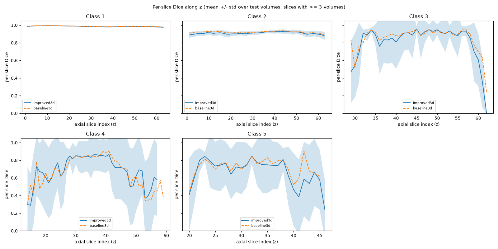

# HipMRI Prostate MRI Segmentation: 3D Improved U-Net (Hard) with 3D U-Net baseline

*COMP3710 Pattern Recognition Report, Marcus Wee Lam Seow, s48747240*

**Selected model: 3D Improved U-Net on downsampled HipMRI 3D volumes (Hard difficulty).** A plain 3D U-Net is used as the baseline for comparison.

## 1. Project description

Radiotherapy planning needs accurate contours of the prostate and the organs around it. This project segments pelvic MRI volumes from the HipMRI study into six labels (label 0 plus five anatomical structures). The task target is Dice >= 0.7 on the test set.

**How it works.** The 3D Improved U-Net follows Isensee et al. (2018), adapted to 3D:
- pre-activation residual *context modules* (two 3x3x3 convolutions with spatial dropout 0.3 between them and a skip connection);
- instance normalisation (GroupNormalization with one group per channel) and leaky ReLU (slope 0.01) in place of batch norm and ReLU;
- strided 3x3x3 convolutions for downsampling (five levels, 16 to 256 filters);
- *localization modules* in the decoder (3x3x3 then 1x1x1 convolution);
- deep supervision: segmentation outputs from the three highest-resolution decoder levels are upsampled and summed before the softmax, which keeps a single output.

It has 8,267,618 parameters. The baseline is a standard 3D U-Net (Cicek et al., 2016): four levels (16 to 128 filters), a 256-filter bottleneck, max pooling, transposed-convolution upsampling, batch norm and ReLU (5,650,886 parameters). Both models use the same data, split, loss and optimiser, and are evaluated on the same 27 test volumes.

**Loss and optimiser.** Mean per-class soft Dice loss plus categorical cross-entropy, Adam (lr 5e-4, halved on validation-loss plateau), batch size 2, up to 100 epochs, early stopping (patience 20) and best-checkpoint saving on validation foreground Dice. The per-class Dice loss is used instead of a global Dice term because a global term is dominated by background voxels, which would otherwise swamp the signal from small structures.


## 2. Data use and acknowledgments

This project uses data from the **HipMRI Study**, accessed via the University of Queensland's Rangpur HPC cluster (`/home/groups/comp3710/HipMRI_Study_open/`), under the terms of the HipMRI Study data use agreement.

**Acknowledgments:** Data were provided in part by the HipMRI Study.

**Citation:** The data use agreement (`data_use_agreement.txt`) leaves the citation for image segmentation blank, so no segmentation-specific citation is given. The following publications listed in the agreement are cited:

- HipMRI Study for MRI-alone treatment planning and other imaging: https://doi.org/10.1016/j.ijrobp.2015.08.045
- HipMRI Study for image synthesis and translation: https://arxiv.org/abs/2011.13615

**Data use terms acknowledged:** no attempt has been made to identify or contact any participant; the data and derived results are used for non-commercial coursework only; no warranty is made regarding the correctness of the data.

## 3. Feasibility review

**Purpose.** To decide, before committing GPU time, whether a 3D Improved U-Net on downsampled HipMRI volumes was feasible and how success would be judged.

**User need and scope.** The user is a radiotherapy treatment planning specialist who contours the prostate and surrounding organs-at-risk on each MRI volume by hand. The prototype proposes draft 3D segmentation masks (six labels) for the specialist to review and edit, not to replace manual contouring. The task is limited to downsampled volumes (128x128x64) from the HipMRI semantic MR and label folders.

**Acceptance criteria.**
1. Dice >= 0.7 on every foreground class on a held-out test set.
2. Strict patient-level separation: every scan of a patient lies in exactly one of train, validation and test, enforced by an assertion.
3. Per-class Dice reported per test volume, with 3 to 5 failure cases inspected visually.
4. Resource limits: peak training memory within one A100 (40 GB), inference under 1 second per volume, and a full training run within a few GPU-hours.
5. The Improved U-Net compared against a plain 3D U-Net on the same split.

**Model choice and course concepts.** The model is a 3D Improved U-Net (Isensee et al., 2018), which is Hard difficulty: residual context modules, instance normalisation with leaky ReLU, strided-convolution downsampling, localization modules and deep supervision. A plain 3D U-Net (Cicek et al., 2016) with skip connections is the baseline. The Dice-plus-cross-entropy loss is computed per class, because small structures such as class 5 occupy about 0.1% of voxels and a global Dice would be dominated by background. Downsampling by 2 in each axis keeps the volumes within GPU memory.

**Preliminary feasibility evidence.**
- *Data audit.* 211 MR volumes pair one-to-one with 211 label volumes from 38 patients. Voxel spacing is about 1.56 mm in all axes. 210 volumes are 256x256x128 and one is 256x256x144 (centre-cropped to 128). Labels take values 0 to 5. In the first label volume, class 5 covers about 0.12% of voxels.
- *Model build.* Both models build with output shape (128, 128, 64, 6): 5,650,886 parameters (baseline) and 8,267,618 parameters (Improved U-Net).
- *Smoke test.* A 16-volume, 2-epoch run on one A100 trained at about 1 s per step with batch size 2 (after a 87 s first-epoch compile), with peak GPU memory of 3.32 GB. Loss fell from 2.02 to 1.02 and mean foreground Dice rose from 0.11 to 0.21.
- *Time estimate.* About 70 steps per epoch at roughly 0.1 to 0.15 s per step puts a full run at well under a GPU-hour, even for 100 epochs. (The smoke test's roughly 1 s per step was measured over only 16 volumes and 2 epochs; the full runs later measured 66 to 135 ms per step, in line with this estimate.)

**Risks, budget and fallback.**

| Risk | Mitigation |
|---|---|
| Few patients (38), so a small, noisy test set | Patient-level split; report per-class Dice and state the limitation |
| Severe class imbalance for small structures | Per-class Dice loss plus cross-entropy |
| Downsampling removes detail of small structures | Nearest-neighbour label sampling; state that Dice is at reduced resolution |
| Memory pressure and node crashes seen on the cluster | Images stored as float16, labels as uint8, one-hot encoding per batch; a crashing node excluded |
| Long queue waits | Smoke test first, short time limits, dependent prediction jobs |

*Compute budget:* one A100 on partition `comp3710`; a 20-minute smoke job, then one training job and one prediction job per model. *Next planned experiment:* the full 100-epoch run of both models with early stopping. *Fallback:* if the Improved U-Net did not train reliably, report the plain 3D U-Net as the delivered model and describe the Improved U-Net as incomplete.

## 4. Data pipeline

Data: `/home/groups/comp3710/HipMRI_Study_open/semantic_MRs` and `semantic_labels_only` (not committed). `B006_Week0_LFOV.nii.gz` pairs with `B006_Week0_SEMANTIC.nii.gz`.

- **Patient-level split.** The first part of the filename (for example `B006`) is the patient ID, and each patient has between 1 and 8 weekly scans. Patients are shuffled with a fixed seed (42) and every scan of a patient goes to exactly one split, with an assertion that the splits are disjoint. The split is 26 / 6 / 6 patients, which gives **136 training, 48 validation and 27 test volumes**. The test patients are J026, K008, S028, T009, T014 and V027. Validation drives early stopping and checkpointing; the test set is used only for final evaluation. I treat the letter-and-number prefix (for example `B006`) as one patient, because every prefix has weekly scans (Week0 to Week7) following the same naming pattern. This is an inference from the filenames and was not confirmed against dataset documentation.
- **Depth fix.** One volume has 144 slices in depth; it is centre-cropped to 128.
- **Downsampling.** 256x256x128 to 128x128x64. Images use 2x2x2 block averaging; labels use strided (nearest-neighbour) sampling so label values stay valid. Class 5 is about 0.1% of voxels at full resolution, so small structures lose detail in this step.
- **Intensity normalisation.** Each volume is z-scored.
- **Memory.** Images are held as float16 and labels as uint8; one-hot encoding happens per batch in the input pipeline. (An earlier version held float32 one-hot arrays in RAM and crashed one node.)
- **Augmentation.** Random flip along axis 0 on the training set only. I assumed axis 0 is the left-right axis. In the prediction slices I inspected, the anatomy appears bilaterally symmetric and consistently oriented, so I saw no sign that the flip created mirrored or misoriented training cases. I did not verify the axis from the NIfTI affine, so this is a visual check only.

## 5. Results

All numbers are from one training run per model. Dice is computed per test volume and averaged, at the 128x128x64 working resolution. Every class is present in all 27 test volumes.

### 5.1 Per-class Dice and IoU (27 test volumes, 6 patients)

| Class | Improved Dice | Improved IoU | Baseline Dice | Baseline IoU |
|---|---|---|---|---|
| 0 | 0.998 | 0.996 | 0.998 | 0.997 |
| 1 | 0.986 | 0.972 | 0.987 | 0.975 |
| 2 | 0.912 | 0.838 | 0.921 | 0.854 |
| 3 | 0.931 | 0.878 | 0.946 | 0.900 |
| 4 | 0.842 | 0.731 | 0.847 | 0.738 |
| 5 | 0.817 | 0.693 | 0.837 | 0.722 |
| **Mean foreground (1 to 5)** | **0.897** | **0.822** | **0.908** | **0.838** |

Dice and IoU are both computed per test volume and averaged. IoU is lower than Dice for every class, as expected.

**Target (Dice >= 0.7):** both models exceed 0.7 on every class, including the weakest (class 5: 0.82 and 0.84). The prostate label was not confirmed against dataset documentation, so results are reported by class number; the target is met on all of them. The target in this report is stated in Dice. Under an IoU >= 0.7 reading, class 5 would be borderline: 0.693 for the Improved U-Net (just under) and 0.722 for the baseline (just over).

The Improved U-Net did **not** beat the plain 3D U-Net: its mean foreground Dice is about 0.01 lower. With single runs on 6 test patients I treat this as a tie, not a loss, and I make no claim about which architecture is better.

### 5.2 Resource profile

| | 3D Improved U-Net | 3D U-Net baseline |
|---|---|---|
| Parameters | 8,267,618 | 5,650,886 |
| Peak GPU memory (training) | 3.93 GB | 3.26 GB |
| Inference per volume (approximate) | 119.9 ms | 49.6 ms |
| Epochs run | 76 of 100 (early stopping; best epoch 56) | 100 of 100 |
| Training step time | about 90 to 135 ms | about 66 to 100 ms |
| Approx. training time | ~11.9 min (76 epochs) | ~11.3 min (100 epochs) |

The Improved U-Net has 1.46x the parameters of the baseline but is about 2.4x slower at inference, because instance normalisation and the extra high-resolution decoder convolutions are expensive.

### 5.3 Failure cases

`predict.py` scores every test volume, finds the weakest class (class 5 for both models), and plots axial slices through the ground-truth region for the three lowest-scoring volumes and the best volume. Figures show input, ground truth, prediction and a difference overlay. Colours are fixed across figures.

| Model | Volume | Class 5 Dice | Class 5 IoU | Figure |
|---|---|---|---|---|
| Improved | J026_Week1 | 0.70 | 0.54 | `predictions_improved3d/vol_00_J026_Week1.png` |
| Improved | J026_Week6 | 0.71 | 0.55 | `predictions_improved3d/vol_01_J026_Week6.png` |
| Improved | T014_Week1 | 0.75 | 0.60 | `predictions_improved3d/vol_02_T014_Week1.png` |
| Improved | V027_Week7 | 0.91 (best) | 0.83 | `predictions_improved3d/vol_03_V027_Week7.png` |
| Baseline | T014_Week2 | 0.75 | 0.60 | `predictions_baseline3d/vol_00_T014_Week2.png` |
| Baseline | J026_Week1 | 0.77 | 0.62 | `predictions_baseline3d/vol_01_J026_Week1.png` |
| Baseline | K008_Week0 | 0.78 | 0.63 | `predictions_baseline3d/vol_02_K008_Week0.png` |
| Baseline | J026_Week7 | 0.90 (best) | 0.82 | `predictions_baseline3d/vol_03_J026_Week7.png` |


Across the six embedded failure figures (four Improved U-Net, two baseline), 
errors fall into two distinct patterns rather than a diffuse
blur:

1. **Boundary leakage on the paired lateral structures** (visible top and
   bottom of each slice): a thin, broken ring of disagreement traces the
   edge of an otherwise correctly detected region. The structure's core is
   right in both ground truth and prediction; only a 1-2 voxel margin at
   its edge is inconsistent.
2. **A denser error cluster at the interface between the two central
   structures** (I did not confirm which anatomical structures these labels are, so I describe them by position only; they appear to be adjacent soft-tissue structures).
   This is where most of the error mass concentrates in every weaker case.
   The input MRI shows little to no intensity contrast at this boundary,
   unlike the sharp edges around bone, so the model has little signal to
   place the boundary precisely.

T014_Week1 and T014_Week2 additionally show a thin vertical line of disagreement on the right side of the difference panel. I checked the outermost voxel layers: ground-truth labels, image and prediction are all zero/background there, and disagreement along the left-right axis is confined to columns 24 to 98 (Week1) and 27 to 96 (Week2), with the right-hand peak at columns 98 and 96. It is therefore not a crop, resize or padding artefact. It lies at an internal boundary, most likely a one- or two-voxel offset in the placement of a structure’s edge, but I did not trace which structure.

The best-performing volume (V027_Week7, Dice 0.91) shows the same two
failure patterns at much smaller scale, suggesting these are a matter of
degree rather than a different failure mode entirely.

Anatomy in all six inspected slices is bilaterally symmetric and
consistent with correctly oriented axial pelvic imaging, so the
left-right flip augmentation (Section 4) does not appear to have
introduced any mirrored or misoriented training cases.

Observations supported by the numbers alone:
- The three worst class-5 volumes per model score 0.70 to 0.78. These are mild shortfalls rather than complete misses.
- J026 contributes the worst volumes for both models (weeks 1 and 6 for the Improved U-Net, week 1 for the baseline), so the weakest results cluster on one patient.
- Both models fail on overlapping volumes (J026_Week1), which suggests the difficulty comes from the data (small structure, low contrast) more than from the architecture.

### 5.4 Dice by slice position (z)

`predict.py` also saves a per-slice Dice profile for each model: `predictions_improved3d/zprofile_improved3d.png` (Improved U-Net solid, baseline overlaid as a dashed line) and `predictions_baseline3d/zprofile_baseline3d.png` (baseline alone). Each plot shows mean ± 1 standard deviation of per-slice Dice across test volumes for classes 1 to 5, using only slices where at least 3 test volumes contribute. z is the axial index in the downsampled 64-slice volume. This shows where along the volume the models fail, which the in-plane figures in 5.3 do not.



What the profiles show (both models behave similarly):
- Classes 1 and 2 are flat across z (about 0.98 to 0.99 and 0.91 to 0.93), with only a small dip in the last slices for class 2 (about 0.88).
- Classes 3, 4 and 5 are strong in the middle of each structure's extent and fall at its ends.
  - Class 3 (present from about z=29 to 62) holds about 0.8 to 0.95 over z=33 to 57. At the low-z end the baseline falls from about 0.83 to about 0.52 at z=30 and the Improved U-Net starts near 0.47 at z=29. At the high-z end the baseline falls from about 0.77 at z=58 to about 0.24 at z=62, and the Improved U-Net falls to close to 0.
  - Class 4 (about z=14 to 59) is highest around z=27 to 42 (about 0.8 to 0.9). It is about 0.3 to 0.7 at z=14 to 25 and about 0.35 to 0.6 beyond z=48.
  - Class 5 (about z=20 to 46) is about 0.7 to 0.85 over z=22 to 38. It starts near 0.4 at z=20 and declines after z=38 to about 0.4 to 0.7 over z=40 to 46 (the Improved U-Net reaches about 0.24 at z=46; the baseline has a single peak of about 0.9 at z=42).
- The standard-deviation bands are widest at the ends (up to about ±0.4), so the end slices are both lower and less consistent between patients.
- Neither model is consistently better along z. Differences are mostly much smaller than the spread between volumes. The Improved U-Net is lower at some end slices (class 3 at z=29 and 62, class 5 at z=41) and higher at others (class 4 at z=52 and 53).

**Interpretation.** I have not confirmed which class is the prostate, so I report the pattern for every class. For classes 3 to 5 the pattern matches the dilemma described in the assignment: a good overall Dice hides weak performance at the first and last slices of a structure. Two explanations are plausible but I did not test them: at the end slices the ground-truth region is small, so a one- or two-voxel error costs a lot of Dice; and a 3D convolution at the end of a structure sees context on only one side of it. I also did not check which end is superior (base) and which is inferior (apex). That depends on the volume orientation in the NIfTI header, which I did not read, so I describe the ends by slice index only.

The in-plane failure figures in 5.3 do not show this problem. Five of the six were taken at z=24 to 33, inside the well-performing range, and the sixth (T014_Week2, z=41) sits at the start of the class 5 decline. The end slices themselves were not visualised, so the in-plane analysis above applies to the mid-structure slices only.

### 5.5 Limitations

- The test set is 27 volumes from 6 patients (several have 8 weekly scans of the same anatomy), so the effective sample is closer to 6 than 27. Differences of about 0.01 are within what I would expect from run-to-run variation.
- Dice is measured at 128x128x64 against strided-downsampled labels, so it is probably optimistic for small structures and is not full-resolution accuracy.
- Single run per model, no confidence intervals, no cross-validation.
- Only the worst three volumes and the best volume per model were inspected.
- The z-profile values at the ends of each structure average only 3 or more volumes from at most 6 patients, so they are noisy; the pattern is clear but the individual values are not precise.

## 6. Dependencies and reproducibility

Python 3.11 (conda env `tf`), tensorflow 2.21.0, nibabel 5.4.2, numpy 2.4.6, matplotlib 3.11.2, tqdm 4.70.1. Run on one NVIDIA A100 40 GB on Rangpur, partition `comp3710`, with no `--mem` request (the nodes reject one).

```bash
sbatch train_3d_job.sh            # 3D Improved U-Net -> checkpoints/improved3d_best.keras
sbatch train_3d_baseline_job.sh   # 3D U-Net baseline -> checkpoints/unet3d_best.keras
sbatch predict_3d_job.sh          # figures in predictions_improved3d/
sbatch predict_3d_baseline_job.sh # figures in predictions_baseline3d/
```

The data split and training shuffle use seed 42, but no global TensorFlow seed is set and GPU kernels are nondeterministic, so reruns give slightly different numbers. Checkpoints are not committed.

| File | Purpose |
|---|---|
| `modules.py` | 3D U-Net baseline, 3D Improved U-Net, per-class Dice loss and metric |
| `dataset.py` | Pairing, patient-level split, resizing, normalisation, batching |
| `train.py` | Training, validation, test evaluation, curves, resource profiling |
| `predict.py` | Per-class Dice and IoU per test volume, per-slice Dice profile along z, failure-case figures |

## 7. Engineering recommendation

The 3D models meet the Dice >= 0.7 target on every class, so a 3D model is a reasonable basis for an annotation assistant that proposes contours for a clinician to review and edit. I would not use it unsupervised yet:
1. **Prefer the simpler model.** The plain 3D U-Net matches the Improved U-Net on every class (about +0.01 mean foreground Dice) at about 2.4x faster inference and 0.7x the parameters, so the added complexity is not justified by this evidence.
2. **Review small structures.** Flag volumes where class 5 is small or has low model confidence for manual review, since the weakest volumes cluster on particular patients.
3. **Validate at full resolution.** Results here are at half resolution in each axis with strided labels; re-evaluate at full resolution before any clinical claim.
4. **More patients.** Use cross-validation over patients, or a larger held-out set, to quantify the variation between patients.
5. **Review the end slices of each structure first.** Dice falls and varies most at the first and last slices of classes 3 to 5 (Section 5.4), so those slices are the cases least suitable for automated drafting without specialist review.

## 8. AI Usage Disclosure

Generative AI (Claude, Anthropic) was used during this project as a coding
and writing assistant, under my direction and with all outputs verified
against real runs on Rangpur before being included here. Specific uses:

- **Architecture implementation.** Claude helped translate the Isensee et
  al. (2018) Improved U-Net and the Cicek et al. (2016) 3D U-Net
  descriptions into TensorFlow/Keras code (`modules.py`), including the
  context modules, strided downsampling, localization modules and deep
  supervision for the Improved U-Net. All architectural choices were
  specified by me (filter counts, dropout rate, normalisation choice); the
  code was reviewed and the parameter counts and output shapes confirmed
  against the real `model.summary()` output in `train_651650.out` and
  `train_651651.out` before being reported.
- **Data pipeline.** Claude assisted with the patient-level train/val/test
  split logic and leakage assertions in `dataset.py`, and with
  diagnosing the real file-naming convention
  (`<PatientID>_Week<N>_LFOV.nii.gz` / `_SEMANTIC.nii.gz`) from directory
  listings I provided.
- **Evaluation and reporting.** Claude helped write the per-class Dice
  scoring and failure-case selection logic in `predict.py`, and helped
  draft this README. All numbers quoted (Dice scores, parameter counts,
  GPU memory, training times, epoch counts, IoU) were taken directly from
  real Slurm job logs (`train_651650.out`, `train_651651.out`,
  `predict_704882.out`, `predict_704883.out`) that I pasted in and that
  Claude did not generate. The failure-case descriptions in Section 5.3
  were drafted by Claude from the prediction figures I shared with it, and
  I reviewed them against the figures myself.
- **Debugging.** Claude helped interpret Slurm/CUDA error messages and git
  workflow issues (merge conflicts, diverged branches) encountered while
  running jobs and syncing code between my laptop and Rangpur.

No AI tool was used to generate or fabricate experimental results; every
number in Section 5 and the resource profile comes from an actual
training/evaluation run on Rangpur, and figures are the real output of
`predict.py`.

